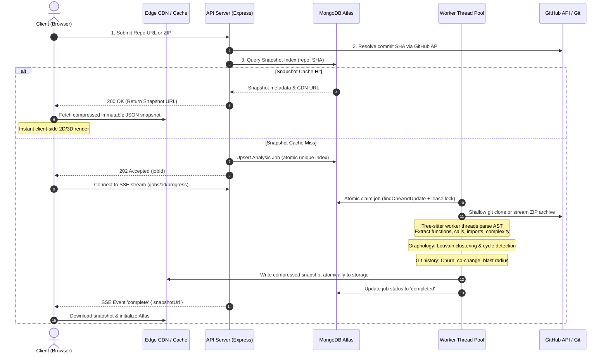
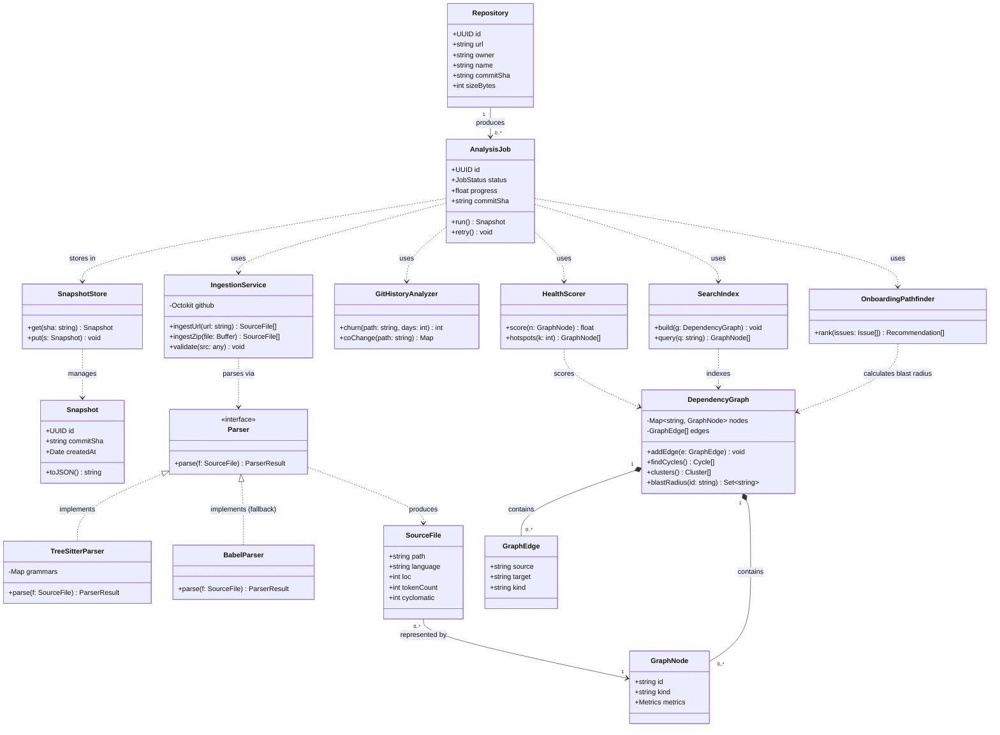

# Constellate 🌌

> **The Astral Cartographer: Interactive Codebase Architecture & AST Explorer**  
> *Transform complex, labyrinthine repositories into navigable, living dependency constellations.*

---

[](#competition--team-information)
[](#competition--team-information)
[](#technology-stack--architecture-decisions)
[](#technology-stack--architecture-decisions)
[-3572A5?logo=webassembly&logoColor=white)](#ast-parsing--graph-engine)
[](#storage--queue-design)
[](./LICENSE)

---

## 📑 Table of Contents

- [The Problem: Navigating Codebase Mazes](#-the-problem-navigating-codebase-mazes)
- [The Solution: Constellate](#-the-solution-constellate)
- [Target Personas](#-target-personas)
- [Key Features](#-key-features)
  - [Foundational Scope](#1-foundational-scope)
  - [Ascended Mastery](#2-ascended-mastery)
  - [Additional Capabilities](#3-additional-capabilities)
- [System Architecture & Ingestion Pipeline](#-system-architecture--ingestion-pipeline)
  - [End-to-End Pipeline Flow](#end-to-end-pipeline-flow)
  - [Architectural Class Diagram](#architectural-class-diagram)
- [Technology Stack & Rationale](#-technology-stack--rationale)
- [Engineering Resilience & Production Hardening](#-engineering-resilience--production-hardening)
  - [Surviving the Deadline Rush](#surviving-the-deadline-rush)
  - [Naive Approach vs. Constellate Smart Engineering](#naive-approach-vs-constellate-smart-engineering)
  - [Integrity, Security & Fault Tolerance](#integrity-security--fault-tolerance)
- [Performance & Benchmarks](#-performance--benchmarks)
- [Getting Started](#-getting-started)
  - [Prerequisites](#prerequisites)
  - [Installation & Setup](#installation--setup)
  - [Environment Variables](#environment-variables)
- [Team Information](#-team-information)
- [License](#-license)

---

## 🧭 The Problem: Navigating Codebase Mazes

Modern software repositories are intricate mazes. Even a modest, mid-sized project can span hundreds of files and tens of thousands of lines of code. The ubiquitous developer toolset—a static file tree, keyword grep, and commit logs—tells you **what files exist**, but completely obscures **how they connect**:

* Which modules depend on which?
* Which file silently acts as a load-bearing "god file" holding the system together?
* Where do circular imports lurk, waiting to trigger runtime crashes?
* Which components are isolated and safe for a newcomer to touch without introducing regressions?

As a consequence, new engineers and open-source contributors burn days just building a mental model. First pull requests land in fragile architectural hotspots, while technical debt and circular dependency chains multiply silently in the dark.

---

## ✨ The Solution: Constellate

**Constellate** turns any public GitHub repository (or direct ZIP archive) into an interactive, multi-dimensional cartographic atlas of its architecture.

By leveraging **Tree-sitter Abstract Syntax Trees (AST)**, graph-theoretic topology algorithms (**Louvain community clustering** & **Tarjan/Kosaraju SCC** for circular imports), and **git churn telemetry**, Constellate generates a deterministic, content-addressed snapshot of a codebase. It delivers immediate spatial comprehension, unmasks architectural debt, and pinpoints safe entry points for newcomers via automated **blast radius** calculations.

---

## 👥 Target Personas

| Persona | Primary Use Case & Benefit |
| :--- | :--- |
| 🎓 **Students & First-Time Contributors** | Discover safe entry points with the **Onboarding Pathfinder**, ranking files and `good-first-issue` tickets by minimal blast radius and existing test coverage. |
| 🏢 **New Hires Onboarding** | Rapidly build high-fidelity mental models of unfamiliar multi-module architectures without endless manual file hopping. |
| 🛡️ **Maintainers & Tech Leads** | Identify architectural hotspots, god-files, hidden circular imports, and modules suffering from high churn coupled with high complexity. |
| 🔍 **Mentors & Reviewers** | Visually articulate architectural boundaries and explain system structure during design and PR reviews. |

---

## 🚀 Key Features

### 1. Foundational Scope
* **Multi-Format Ingestion**: Ingests public repositories directly via GitHub URL or streaming `.zip` upload with automatic language detection.
* **Interactive Dependency Atlas**: Force-directed **2D (HTML5 Canvas)** and **3D (WebGL)** visualization with smooth multi-thousand-node physics and hierarchical views.
* **Synchronized Code Exploration Panel**: Embedded [CodeMirror 6](file:///c:/Users/HP/constellate/Constellate/README.md) side-by-side viewer highlighting file tokens, cyclomatic complexity, module imports, and exact lines causing circular cycles.
* **Instant Search & Semantic Filtering**: Fast search indexing across files, functions, and symbols; dynamically recenters the camera and spotlights incoming/outgoing dependency cones.

### 2. Ascended Mastery
* **Deep AST Parsing Engine**: Worker-thread Tree-sitter parsing extracting function-level call graphs, call sites, and exact circular import cycle chains.
* **Architectural Health Scoring**: Churn-versus-complexity heatmap matrix highlighting fragile god files and technical-debt gravity wells.
* **Smart Onboarding Pathfinder**: Computes **blast radius** (reverse reachability in the dependency graph) combined with test density and churn to rank the safest files and match relevant open `good-first-issue` tickets.

### 3. Additional Capabilities
* **Co-Change Telemetry Overlay**: Surfaces coupled files that are frequently modified together in git history even when no direct import edge connects them.
* **Per-Commit Content-Addressed Permalinks**: Every snapshot is permanently keyed to its git commit SHA (`owner/repo@SHA`), enabling immutable sharing and zero-cost re-renders.
* **One-Click Export**: Export the dependency atlas directly as PNG, SVG, or raw JSON snapshots.
* **Parchment & Crimson Aesthetic**: Immersive visual identity tailored to the Webster theme, complete with real-time SSE progress streaming.

---

## 🏗️ System Architecture & Ingestion Pipeline

Constellate uses a tiered asynchronous pipeline to ensure expensive CPU-bound parsing never impacts request serving.

### End-to-End Pipeline Flow



---

### Architectural Class Diagram



---

## 🛠️ Technology Stack & Rationale

Every dependency was thoroughly vetted for active maintenance, backing, issue resolution velocity, and licensing compliance.

| Layer / Component | Chosen Technology | Why We Chose It | Alternatives Considered & Rejected | License |
| :--- | :--- | :--- | :--- | :--- |
| **Frontend Framework** | **React + Vite** | Instant HMR, lightweight production bundles, rich ecosystem for complex synchronized panels (viewer, graph, metrics). | *Next.js* (unnecessary SSR overhead for an SPA tool); *Angular* (unwieldy for a fast 3-person build). | MIT |
| **Graph Atlas Visualization** | **react-force-graph**<br>*(Canvas 2D + WebGL 3D)* | Unified API powering both 2D Canvas and 3D WebGL renderers; maintains 60 FPS with thousands of nodes; built-in physics, zoom, drag, and node picking. | *Raw D3 SVG* (drastic frame drops > 300 nodes); *Cytoscape.js* (lacks 3D view); *Sigma.js* (WebGL 2D only). | MIT |
| **AST Code Parsing** | **Tree-sitter (WASM)**<br>*(Babel fallback for JS/TS)* | Polyglot support, highly resilient to syntax errors and incomplete files, extremely fast, runs in isolated worker threads without native compile baggage. | *Babel/TS Compiler API* (restricted to JS/TS); *Regex matching* (fails on aliased/dynamic imports); *ANTLR* (excessive grammars setup). | MIT |
| **Graph Algorithms & Clustering** | **Graphology + Louvain** | Dedicated graph data structures with production-ready community detection and Tarjan SCC for cycle resolution. | *NetworkX* (requires Python runtime); *Custom adjacency list* (reinventing graph theory with higher bug risk). | MIT |
| **Code Viewer** | **CodeMirror 6** | Modern, headless, modular, and fast. Supports read-only line decorations (visualizing cycle-triggering imports) without heavy background workers. | *Monaco* (excessive memory footprint); *Prism/highlight.js* (lack virtualized DOM and custom line decoration APIs). | MIT |
| **Repository Data API** | **Octokit (@octokit/rest)** | Official GitHub SDK handling authentication, pagination, and rate-limit headers natively. | *Raw Fetch* (manual retry/rate limit handling); *Web Scraping* (fragile, violates GitHub ToS). | MIT |
| **Backend API Server** | **Node.js + Express** | Non-blocking asynchronous I/O ideal for job coordination; shares language and data models with frontend and WASM Tree-sitter. | *Python/FastAPI* (multi-language overhead); *Go* (slower development iteration). | MIT |
| **Queue & Metadata DB** | **MongoDB + Node Driver** | Documents map naturally to AST snapshots. Atomic `findOneAndUpdate` provides a reliable distributed job lock without spinning up a Redis cluster. | *PostgreSQL/pg-boss* (relational mismatch); *Redis/BullMQ* (extra infra overhead); *In-memory arrays* (data loss on restarts). | SSPL / Apache-2.0 |
| **Git History Analysis** | **simple-git (Native CLI)** | Direct access to native `git log --numstat` for accurate churn and co-change analysis, plus shallow, depth-limited clone support. | *isomorphic-git* (pure JS, slower on large history); *GitHub Commits API* (heavily rate-limited). | MIT |
| **Validation & Uploads** | **yauzl + Zod** | `yauzl` streams ZIP entries with strict path traversal checks (anti-Zip-Slip); `Zod` provides end-to-end type validation on all API inputs. | *adm-zip* (loads entire archive into RAM, vulnerable path parsing); *Manual checks* (error-prone). | MIT |
| **Testing & Load Measurement** | **Vitest + autocannon** | Lightning-fast unit tests for graph and AST parsing algorithms; `autocannon` generates verifiable concurrency and latency benchmarks. | *Jest* (slower startup); *Manual profiling* (non-reproducible). | MIT |

---

## ⚡ Engineering Resilience & Production Hardening

### Surviving the Deadline Rush

When hundreds of users submit large repositories simultaneously in high-stress submission periods, Constellate protects its infrastructure through five deliberate layers of engineering defense:

```
[ Inbound Submissions ]
          │
          ▼
┌───────────────────────────────────────────────┐
│ 1. Admission Control                          │
│    • Per-IP token-bucket rate limiter         │
│    • Strict caps: 150 MB archive,             │
│      20,000 files, 90s max processing timeout │
└───────────────────────┬───────────────────────┘
                        ▼
┌───────────────────────────────────────────────┐
│ 2. Exact De-duplication                       │
│    • Content-addressed index on (repo, SHA)   │
│    • Concurrent identical requests share 1 job│
└───────────────────────┬───────────────────────┘
                        ▼
┌───────────────────────────────────────────────┐
│ 3. Bounded Back-Pressure                      │
│    • Fixed worker pool concurrency            │
│    • Live SSE queue position (never timeout)  │
└───────────────────────┬───────────────────────┘
                        ▼
┌───────────────────────────────────────────────┐
│ 4. Child-Process & Worker Isolation           │
│    • Memory-bounded sub-processes             │
│    • Pathological crashes cannot kill the API │
└───────────────────────┬───────────────────────┘
                        ▼
┌───────────────────────────────────────────────┐
│ 5. Progressive Client Rendering               │
│    • Server precomputes Louvain clusters      │
│    • Browser draws top-ranked nodes first     │
└───────────────────────────────────────────────┘
```

---

### Naive Approach vs. Constellate Smart Engineering

| Engineering Dimension | ❌ The Naive / Basic Way | ✅ Constellate Smart Engineering |
| :--- | :--- | :--- |
| **Execution Path** | Clones full git history inside the synchronous HTTP request handler. | **Off-request async queue**; API remains 100% non-blocking and responds in constant time ($O(1)$). |
| **Event Loop Health** | Parses AST on the main Node.js thread, freezing all concurrent user requests. | Offloads CPU-intensive Tree-sitter parsing to a dedicated **Worker Thread Pool**. |
| **Snapshot Caching** | Re-clones and re-analyzes identical repositories for every visiting user. | **Content-addressed snapshots** keyed by commit SHA; subsequent hits return in milliseconds. |
| **DOM / Rendering** | Dumps thousands of raw SVG elements into the DOM, freezing the browser tab. | High-performance **Canvas 2D / WebGL 3D** with level-of-detail (LOD) clustering. |
| **Error Containment** | One corrupt ZIP or memory-heavy repository crashes the entire server process. | **Isolated sandboxed child processes** with enforced memory ceilings and retry backoff. |

---

### Integrity, Security & Fault Tolerance

* **Zero-Execution Code Sandboxing**: Repository code is strictly treated as text for AST parsing. Code is **never executed or evaluated** in any environment.
* **Zip-Slip & Path Traversal Prevention**: ZIP extraction via `yauzl` inspects canonical file paths to block `../` attacks and ignores symlinks pointing outside the sandbox.
* **Atomic Snapshot Persistence**: Snapshots are written to temporary staging files and swapped into place using atomic renames. Snapshot document metadata in MongoDB is inserted in a single atomic write, guaranteeing clients never read corrupted or partial graphs.
* **Lease-Based Worker Recovery**: Workers acquire jobs with time-bounded, renewable lock leases. If a worker process abruptly dies, its lock expires cleanly and the queue retries the task with exponential backoff.
* **GitHub Rate Limit Graceful Degradation**: When unauthenticated GitHub API limits are approached, the system serves cached snapshot data for known commits and schedules background retries timed precisely to GitHub's `X-RateLimit-Reset` header.

---

## 📊 Performance & Benchmarks

The platform is designed against explicit, measurable performance targets:

* ⚡ **Cache-Hit Response Time**: $< 50\text{ ms}$ (served from Edge / in-memory LRU cache).
* ⏱️ **First Render Time (500-file repository)**: $< 4.5\text{ seconds}$ from cold submission to complete 3D constellation.
* 🖥️ **Visualization Frame Rate**: Stable **60 FPS** on standard hardware rendering graphs up to $5,000$ active nodes.

---

## 🚀 Getting Started

### Prerequisites

* **Node.js**: `v18.x` or later (LTS recommended)
* **npm**: `v9.x` or later
* **Git**: CLI installed and available in system `$PATH`
* **MongoDB**: Local instance running on port `27017` or a MongoDB Atlas URI

---

### Installation & Setup

1. **Clone the repository**:
   ```bash
   git clone https://github.com/kumarkrrish096-alt/Constellate.git
   cd Constellate
   ```

2. **Install dependencies**:
   ```bash
   npm install
   ```

3. **Configure environment variables**:
   Create a `.env` file in the root directory:
   ```env
   PORT=5000
   MONGODB_URI=mongodb://localhost:27017/constellate
   GITHUB_TOKEN=your_github_personal_access_token_here
   NODE_ENV=development
   MAX_ARCHIVE_SIZE_MB=150
   MAX_FILE_COUNT=20000
   ANALYSIS_TIMEOUT_SEC=90
   ```

4. **Run the development servers**:
   ```bash
   # Start the API backend and frontend concurrently
   npm run dev
   ```

5. **Run test suites & benchmarks**:
   ```bash
   # Run Vitest unit & AST parsing tests
   npm run test

   # Run Autocannon load and concurrency benchmarks
   npm run bench
   ```

---

## 🧙‍♂️ Team Information

### **Team: Forbidden Wizards (Team ID: 145)**
*Event: Webster 2026 | Problem Statement 06: The Astral Cartographer*

* 🧙 **Krrish** — `20244098`, ECE
* 🧙 **Krish Bhalotia** — `20244095`, ECE
* 🧙 **Sujal Jain** — `20248025`, ECM

---

## 📜 License

This project is licensed under the **MIT License**. See the [LICENSE](file:///c:/Users/HP/constellate/Constellate/LICENSE) file for complete details.